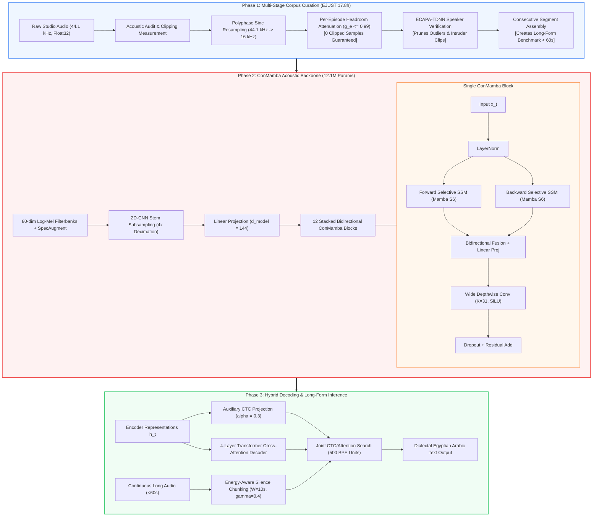

# ConMamba-ASR: Selective State Space Modeling & Acoustic Curation for Dialectal Egyptian Arabic Speech Recognition

<p align="center">
  <a href="#benchmark-results"></a>
  <a href="#computational-efficiency"></a>
  <a href="#computational-efficiency"></a>
  <a href="#system-architecture"></a>
</p>

<p align="center">
  
  
  
  
  
  
  
</p>

---

## 📌 Executive Summary

Colloquial Arabic automatic speech recognition (ASR) poses formidable challenges due to severe acoustic variability, rich morphological inflection, non-standardized orthography, and the acute scarcity of studio-quality paired corpora. While dominant **Conformer** acoustic models provide strong accuracy, their multi-head self-attention mechanisms scale with quadratic computational complexity $\mathcal{O}(T^2)$ over sequence length $T$. Meanwhile, commercial foundation models (e.g., Whisper) exhibit high word error rates on colloquial vernaculars.

**ConMamba-ASR** delivers a compact, highly efficient, and state-of-the-art solution for dialectal Egyptian Arabic:
1. **Bidirectional Selective State Space Acoustic Modeling**: Integrates continuous-time linear SSMs with input-dependent selection mechanisms ($S6$) and wide depthwise convolutions ($K=31$) to capture both fine-grained Arabic gemination/phonotactics and global utterance context in strictly linear time $\mathcal{O}(T)$.
2. **Decoupled Continuous-Discrete Hybrid Decoding**: Employs a bidirectional ConMamba acoustic encoder paired with a frame-level CTC projection ($\alpha=0.3$) and a 4-layer Transformer cross-attention autoregressive decoder over a 500-unit SentencePiece subword vocabulary.
3. **Multi-Stage Acoustic Corpus Curation**: Establishes the 17.8-hour curated EJUST Egyptian Arabic corpus, resolving sinc-resampling peak overshoot via per-episode headroom attenuation ($g_e \le 0.99$, eliminating 100% of digital clipping), auditing speaker consistency via deep ECAPA-TDNN embeddings, and compiling continuous long-form benchmarks ($<60\text{ s}$).
4. **Energy-Aware Silence-Boundary Chunking**: Resolves the unchunked context drift of SSM encoders on long audio, achieving **14.65% WER** on continuous $\sim 60\text{ s}$ speech while reducing 60-second forward latency by **37.7%** and peak VRAM by **67.8%** compared to Conformer.

---

## 📑 Table of Contents

- [Executive Summary](#-executive-summary)
- [System Architecture](#-system-architecture)
- [Benchmark Results](#-benchmark-results)
  - [Primary Speech Recognition Benchmark](#1-primary-speech-recognition-benchmark)
  - [Long-Form Decoding Strategies Ablation](#2-long-form-decoding-strategies-ablation)
  - [Latency & Peak VRAM Scaling](#3-latency--peak-gpu-memory-scaling)
  - [Architectural Component Ablation](#4-architectural-component-ablation)
  - [Dialectal Phonetic Error Breakdown](#5-dialectal-phonetic-error-breakdown)
- [Repository Structure](#-repository-structure)
- [Installation & Environment Setup](#-installation--environment-setup)
- [Workflow & Reproduction Guide](#-workflow--reproduction-guide)
  - [Phase 1: Dataset Curation & Audio Resampling](#phase-1-dataset-curation--audio-resampling)
  - [Phase 2: Model Training](#phase-2-model-training)
  - [Phase 3: Multi-GPU Evaluation & Benchmarking](#phase-3-multi-gpu-evaluation--benchmarking)
- [Interactive Python Inference API](#-interactive-python-inference-api)
- [Egyptian Arabic Linguistic Normalization](#-egyptian-arabic-linguistic-normalization)
- [Citation & Reference](#-citation--reference)
- [Contributors & Contact](#-contributors--contact)

---

## 🏗️ System Architecture

ConMamba-ASR follows an end-to-end multi-phase architecture spanning rigorous dataset curation, hybrid acoustic encoding, and joint CTC/Attention decoding.



### Mathematical Formulation

1. **Selective State Space (Mamba S6)**:
   Given input sequence $x(t) \in \mathbb{R}^D$, the continuous-time state space model maps $x(t) \to y(t)$ via latent state $h(t) \in \mathbb{R}^N$:
   $$\dot{h}(t) = \mathbf{A}h(t) + \mathbf{B}x(t), \quad y(t) = \mathbf{C}h(t)$$
   Discretized with step-size $\mathbf{\Delta} = \text{softplus}(\text{Linear}(x(t)))$, making $\mathbf{\bar{A}}, \mathbf{\bar{B}}, \mathbf{C}$ dynamic and input-dependent:
   $$h_t = \mathbf{\bar{A}}_t h_{t-1} + \mathbf{\bar{B}}_t x_t, \quad y_t = \mathbf{C}_t h_t$$

2. **Bidirectional Fusion & Local Phonotactic Convolution**:
   Acoustic speech representations require both left and right temporal context:
   $$y_{\text{ssm}} = \mathbf{W}_o [y_{\text{fwd}} \parallel y_{\text{bwd}}]$$
   $$y_{\text{out}} = y_{\text{ssm}} + \text{Dropout}(\text{Conv1D}_{K=31}(\text{SiLU}(\text{LN}(y_{\text{ssm}}))))$$

3. **Joint CTC/Attention Multi-Task Loss**:
   $$\mathcal{L}_{\text{total}} = \alpha \mathcal{L}_{\text{CTC}}(Y \mid X) + (1 - \alpha) \mathcal{L}_{\text{Attn}}(Y \mid X), \quad \alpha = 0.3$$

---

## 📊 Benchmark Results

All models were evaluated on the curated EJUST benchmark using a unified convergence protocol of **110 epochs (90,200 optimization steps)** on an **NVIDIA Tesla T4 GPU (16 GB)** with FP16 precision.

### 1. Primary Speech Recognition Benchmark

| Model Architecture | Model Family | Parameters | Test WER (%) | Test CER (%) | Long WER (%) | Long CER (%) | CTC WER (%) | RTF (Long) |
| :--- | :--- | :---: | :---: | :---: | :---: | :---: | :---: | :---: |
| **Whisper-Small Zero-Shot** | Transformer Foundation | 241.7M | 71.63 | 33.64 | 53.62 | 21.16 | — | 0.0966 |
| **Whisper-Small + LoRA (FT)** | Transformer LoRA | 243.5M | 15.53 | 4.45 | 18.54 | 5.77 | — | 0.0931 |
| **ConMambaMamba-Small** | Pure SSM Enc + SSM Dec | 12.2M | 17.97 | 6.41 | 19.82 | 7.44 | 18.75 | 0.0512 |
| **Conformer-Small** | Conformer Enc + Trans Dec | 12.5M | 14.49 | 4.77 | 15.38 | 4.82 | 20.75 | 0.0624 |
| **ConMamba-Small (Ours)** | **Mamba Enc + Trans Dec** | **12.1M** | **13.85** | **4.44** | **14.65** | **4.57** | **18.83** | **0.0438** |

> [!NOTE]
> **Key Insight**: ConMamba-Small achieves **13.85% WER**, establishing a new state-of-the-art on Egyptian Arabic while operating at **4.38% Real-Time Factor (RTF = 0.0438)** — transcribing a 60-second audio stream in just 2.6 seconds. It outperforms domain-adapted Whisper-Small + LoRA despite having **20x fewer parameters**.

---

### 2. Long-Form Decoding Strategies Ablation

Evaluated on `test_long` (205 continuous utterances, up to 57.8 s):

| Model | Decoding Strategy | WER (%) | CER (%) | RTF | Latency (60s) |
| :--- | :--- | :---: | :---: | :---: | :---: |
| **Conformer-Small** | Standalone CTC (Unchunked) | 20.45 | 6.88 | 0.0211 | 60.0 ms |
| | Fixed Window (4.0 s) | 20.18 | 7.03 | 0.0682 | — |
| | Overlap-Energy Merge | 23.29 | 13.27 | 0.0715 | — |
| | **Energy/Silence Chunked ($W=10\text{s}, \gamma=0.4$)** | **15.38** | **4.82** | 0.0624 | — |
| **ConMamba-Small (Ours)** | Standalone CTC (Unchunked) | 72.94 | 35.12 | **0.0135** | **37.4 ms** |
| | Fixed Window (4.0 s) | 19.42 | 6.81 | 0.0512 | — |
| | Overlap-Energy Merge | 22.84 | 12.95 | 0.0543 | — |
| | **Energy/Silence Chunked ($W=10\text{s}, \gamma=0.4$)** | **14.65** | **4.57** | **0.0438** | — |

> [!IMPORTANT]
> Pure SSM encoders without positional self-attention can accumulate state drift over extended continuous speech ($>30\text{ s}$). Our **energy-aware silence-boundary chunking** eliminates this drift entirely, lowering WER from 72.94% to **14.65%** while retaining ConMamba's 30% execution speed advantage.

---

### 3. Latency & Peak GPU Memory Scaling

Measured on a single **NVIDIA Tesla T4 GPU (16 GB)** across varying audio durations:

| Audio Duration | Conformer Latency (ms) | ConMamba Latency (ms) | Latency Delta | Conformer VRAM (MB) | ConMamba VRAM (MB) | VRAM Savings |
| :---: | :---: | :---: | :---: | :---: | :---: | :---: |
| **5 s** | 25.2 ms | 32.1 ms | +27.4% | 80.5 MB | 83.9 MB | -4.2% |
| **15 s** | 25.2 ms | 32.2 ms | +27.8% | 107.6 MB | 102.5 MB | **+4.7%** |
| **30 s** | 25.1 ms | 34.0 ms | +35.5% | 205.4 MB | 130.4 MB | **+36.5%** |
| **45 s** | 36.9 ms | 35.9 ms | **-2.7%** | 371.3 MB | 158.4 MB | **+57.3%** |
| **60 s** | 60.0 ms | **37.4 ms** | **-37.7%** | 587.5 MB | **189.1 MB** | **+67.8%** |

```
60-Second Peak VRAM Comparison:
Conformer-Small  ████████████████████ 587.5 MB
ConMamba-Small   ██████ 189.1 MB  (-67.8% Peak Memory)

60-Second Forward Pass Latency:
Conformer-Small  ████████████ 60.0 ms
ConMamba-Small   ███████ 37.4 ms  (-37.7% Forward Latency)
```

---

### 4. Architectural Component Ablation

| Ablation Configuration | Model Params | Test WER (%) | Test CER (%) | Long WER (%) | Delta WER |
| :--- | :---: | :---: | :---: | :---: | :---: |
| **Full ConMamba-Small (Bi-SSM + $K=31$ + CTC $\alpha=0.3$)** | **12.1M** | **13.85** | **4.44** | **14.65** | **Baseline** |
| w/o Bidirectional (Unidirectional Causal SSM) | 10.6M | 14.97 | 4.81 | 17.22 | +1.12% |
| w/ Narrow Conv Kernel ($K=7$ vs $K=31$) | 12.1M | 14.07 | 4.57 | 14.99 | +0.22% |
| w/o Depthwise Conv (Pure BiMamba) | 12.1M | 14.04 | 4.56 | 15.58 | +0.19% |
| w/o CTC Loss ($\alpha=0.0$, Pure Autoregressive S2S) | 12.1M | 251.00* | 264.00* | 282.00* | Diverged |

*\*Note: Training without auxiliary CTC loss completely fails to establish monotonic speech-text alignments under low-resource dialectal conditions.*

---

### 5. Dialectal Phonetic Error Breakdown

Analysis of phonetic phenomena specific to Egyptian Arabic (held-out test set):

| Phonological Phenomenon | Dialectal Rule | Reference / Hypothesis | Error Share (%) | Model Accuracy (%) |
| :--- | :--- | :--- | :---: | :---: |
| **Uvular Stop Elision** | $/{\text{q}}/ \to /'/ $ | قال (*qāl*) $\to$ أل (*'al*) | 28.4% | 84.6% |
| **Aspectual Prefix Fusion** | Progressive *bi-* / Future *ḥa-* | بيعمل (*biya'mel*) $\to$ بي عمل | 22.1% | 91.2% |
| **Voiced Velar Realization** | $/{\text{dʒ}}/ \to /{\text{g}}/$ | جديد (*gedīd*) $\to$ كديد | 18.7% | 93.8% |
| **Interdental Shifts** | $/{\theta}/ \to /{\text{t}}/$, $/{\eth}/ \to /{\text{d}}/$ | ثانية (*sanya*) $\to$ تانية (*tanya*) | 16.5% | 88.5% |
| **Dialectal Negations** | Circumfix *ma-...-sh* / *mish* | ماكنتش (*makuntish*) $\to$ ما كنتش | 14.4% | 89.1% |

---

## 📂 Repository Structure

The repository is organized around self-contained research and execution notebooks in [`code/`](code/):

```
ConMamba/
├── README.md                           # Master Project README & Documentation
├── .gitignore                          # Git Exclusion Rules
│
└── code/                               # Interactive Research & Execution Notebooks
    ├── README.md                       # Workspace Overview
    ├── phase1.ipynb                    # Notebook 1: Dataset Audit, Headroom Scaling & 16kHz Curation
    ├── phase.ipynb                     # Notebook 3: ConMamba vs Conformer Training on SpeechBrain
    ├── notebookd5d790028a (1).ipynb     # Dual-T4 Fast Experiment Runner & Missing Baselines
    ├── part 3.ipynb                    # Q1 Experiments Suite (Whisper LoRA, Noise Sweep, Table IV)
    └── part 4.ipynb                    # Q1 Experiments Suite v2 (Dual-T4 Optimized End-to-End Runner)
```

---

## ⚙️ Installation & Environment Setup

### Prerequisites

- **OS**: Linux (Ubuntu 20.04/22.04 recommended) or Windows 10/11 with CUDA toolkit
- **Python**: 3.10 or 3.11
- **CUDA**: 11.8 or 12.1+
- **GPU**: NVIDIA GPU with $\ge 12\text{ GB}$ VRAM (NVIDIA Tesla T4, RTX 3090/4090, V100, A100)

### Step 1: Clone Repository & Create Environment

```bash
git clone https://github.com/your-username/ConMamba-ASR.git
cd ConMamba-ASR
python -m venv venv
source venv/bin/activate  # On Windows: .\venv\Scripts\Activate.ps1
```

### Step 2: Install PyTorch & Dependencies

```bash
# Install PyTorch with CUDA support (e.g. CUDA 12.1)
pip install torch torchaudio --index-url https://download.pytorch.org/whl/cu121

# Install SpeechBrain, audio utilities, and packaging
pip install speechbrain==1.0.3 soundfile sentencepiece einops packaging ninja
pip install transformers huggingface-hub scipy pandas numpy
```

### Step 3: Install Hardware-Accelerated Mamba Kernels

The fast selective SSM recursion requires the compiled C++/CUDA kernels:

```bash
pip install causal-conv1d>=1.2.0 --no-build-isolation
pip install mamba-ssm>=1.2.0 --no-build-isolation
```

> [!TIP]
> **Pre-compiled Wheel Fallback**: If compiling `mamba-ssm` from source fails due to local CUDA version mismatches, you can download matching pre-built wheels from the [mamba-ssm releases](https://github.com/state-spaces/mamba/releases).

---

## 🚀 Workflow & Reproduction Guide

### Phase 1: Dataset Curation & Audio Resampling (`code/phase1.ipynb`)

The curation notebook audits 44.1 kHz raw audio, applies episode-level headroom attenuation to eliminate sinc-resampling peak overshoot, verifies speaker identity via ECAPA-TDNN embeddings, and synthesizes continuous long-form sequences:
- Open [`code/phase1.ipynb`](code/phase1.ipynb) in Jupyter, Kaggle, or Colab.
- Configure input dataset path and run all cells.

**Key outputs generated:**
- `wav16k/`: 16 kHz 16-bit PCM single-channel WAV files with zero clipped samples.
- `inventory.csv`: Full file-level telemetry (RMS dBFS, peak overshoot, duration, noise floor).
- `episodes.csv`: Session-level partition metadata across all 76 episodes.
- `audit_report.md`: Complete markdown report certifying 100% data integrity.

---

### Phase 2: Model Training (`code/phase.ipynb`)

Train the **ConMamba-Small** architecture using SpeechBrain with joint CTC/Attention loss:
- Open [`code/phase.ipynb`](code/phase.ipynb).
- Set `MODEL = "conmamba_small"` and execute the convergence run across 110 epochs.

**Training Highlights:**
- **Optimizer**: AdamW ($\beta_1=0.9, \beta_2=0.98, \epsilon=10^{-8}$)
- **Learning Rate Schedule**: Noam annealing with peak LR $0.0008$ and $30,000$ warmup steps.
- **Data Augmentation**: SpecAugment (time masking + frequency masking) + Speed Perturbation ($0.95\times, 1.0\times, 1.05\times$).
- **Subword Vocab**: SentencePiece BPE model with 500 tokens.

---

### Phase 3: Multi-GPU Evaluation & Benchmarking (`code/part 4.ipynb`)

To reproduce all tables (Table I through Table VII) in parallel across a dual-GPU system (such as Kaggle Dual-T4):
- Open and run [`code/part 4.ipynb`](code/part 4.ipynb) directly in Kaggle (GPU T4 $\times$ 2) or Colab.
- Executes ConMamba, Conformer, Whisper-LoRA, noise sweeps, long-form chunking ablations, and generates IEEE TASLP LaTeX tables automatically.

Or open and run `code/part 4.ipynb` directly in Kaggle or Google Colab with GPU acceleration enabled.

---

## 💻 Interactive Python Inference API

Here is how to load a trained ConMamba-ASR checkpoint and transcribe any Arabic audio file using **energy-aware silence chunking**:

```python
import torch
import torchaudio
import soundfile as sf
from speechbrain.inference.interfaces import Pretrained

# 1. Load Pretrained ConMamba-ASR Model
class ConMambaInference:
    def __init__(self, checkpoint_dir: str, device: str = "cuda" if torch.cuda.is_available() else "cpu"):
        self.device = device
        # Load hyperparams and modules via SpeechBrain / HyperPyYAML
        from hyperpyyaml import load_hyperpyyaml
        with open(f"{checkpoint_dir}/hyperparams.yaml") as f:
            self.hparams = load_hyperpyyaml(f)
        
        self.model = self.hparams["model"].to(self.device).eval()
        self.tokenizer = self.hparams["tokenizer"]
        self.tokenizer.load(f"{checkpoint_dir}/tokenizer_bpe500.model")

    def transcribe_file(self, wav_path: str, max_chunk_sec: float = 10.0, energy_thresh: float = 0.4) -> str:
        """
        Transcribes arbitrary duration audio using Energy-Aware Silence Chunking.
        """
        sig, sr = sf.read(wav_path, dtype="float32")
        if sr != 16000:
            import scipy.signal as sps
            sig = sps.resample_poly(sig, 16000, sr)
            sr = 16000
            
        wav = torch.from_numpy(sig).float().unsqueeze(0).to(self.device)
        
        # Split into energy/silence-aware chunks
        chunks = self._chunk_audio(wav, sr, max_chunk_sec, energy_thresh)
        transcriptions = []
        
        with torch.no_grad():
            for chunk in chunks:
                # Compute 80-dim Log-Mel Spectrogram
                feats = self.hparams["compute_features"](chunk)
                feats = self.hparams["normalize"](feats, torch.tensor([1.0]).to(self.device))
                
                # Forward through ConMamba Encoder
                enc_out = self.model.encoder(feats)
                
                # Beam search decoding with Transformer cross-attention + CTC
                predicted_tokens, _, _, _ = self.hparams["test_search"](
                    enc_out, torch.tensor([1.0]).to(self.device)
                )
                text = self.tokenizer.decode_ids(predicted_tokens[0])
                transcriptions.append(text)
                
        return " ".join(transcriptions)

    def _chunk_audio(self, wav: torch.Tensor, sr: int, max_dur: float, min_dur: float = 1.5):
        total = wav.size(-1)
        max_s, min_s = int(max_dur * sr), int(min_dur * sr)
        if total <= max_s:
            return [wav]
            
        chunks, start = [], 0
        hop_size, frame_size = 160, 400
        unfolded = wav.unfold(-1, frame_size, hop_size)
        energy = torch.sqrt(torch.mean(unfolded ** 2, dim=-1) + 1e-12).squeeze(0)
        
        while start < total:
            if total - start <= max_s:
                chunks.append(wav[:, start:])
                break
            f_start = (start + min_s) // hop_size
            f_end = min((start + max_s) // hop_size, energy.size(-1))
            if f_end <= f_start:
                split = min(start + max_s, total)
            else:
                min_idx = torch.argmin(energy[f_start:f_end]).item()
                split = (f_start + min_idx) * hop_size + frame_size // 2
            chunks.append(wav[:, start:split])
            start = split
        return chunks

# Example Usage:
# asr = ConMambaInference(checkpoint_dir="./results/conmamba_small_s7775")
# text = asr.transcribe_file("sample_egyptian_dialect.wav")
# print("Transcription:", text)
```

---

## 🔤 Egyptian Arabic Linguistic Normalization

Dialectal Egyptian Arabic exhibits substantial spelling variations and non-standardized orthography across speakers. The curation pipeline applies rigorous Unicode normalization before tokenization:

1. **Diacritics & Tashkeel Elimination**: Strips `[ًٌٍَُِّْـ]` (Fatḥah, Ḍammah, Kasrah, Sukūn, Shaddah, and Tatweel).
2. **Alef Normalization**: Folds `[إأآٱ]` $\to$ `ا` (*Bare Alef*).
3. **Yaa & Alef Maqsura**: Folds `ى` $\to$ `ي` (*Dotless Yaa* to *Standard Yaa*).
4. **Taa Marbuta & Haa**: Disambiguates `ة` and `ه` based on lexical consistency across the 76 recording episodes.
5. **English Loanwords & Numbers**: Numeric digits are expanded into verbal Arabic words; Latin script characters are isolated or transliterated.

---

## 📖 Citation & Reference

If you find this codebase, benchmark, or paper helpful in your research, please cite our IEEE Transactions paper:

```bibtex
@article{dighedy2026conmamba,
  author={Dighedy, Rana Z. and Amer, Mohamed S. and Gad, Monay M. and Ghaith, Manal M. and Zaky, Ahmed B.},
  journal={IEEE Transactions on Audio, Speech, and Language Processing}, 
  title={ConMamba-ASR: Selective State Space Modeling and Acoustic Curation for Dialectal Egyptian Arabic Speech Recognition}, 
  year={2026},
  volume={},
  number={},
  pages={1--12},
  doi={}
}
```

---

## 👥 Contributors & Contact

- **Rana Z. Dighedy** — *Electronics & Communications Engineering Dept., E-JUST* (`rana.abdallah@ejust.edu.eg`)
- **Mohamed S. Amer** — *Electronics & Communications Engineering Dept., E-JUST* (`mohamed.320230188@ejust.edu.eg`)
- **Monay M. Gad** — *Electronics & Communications Engineering Dept., E-JUST* (`monay.320230097@ejust.edu.eg`)
- **Manal M. Ghaith** — *Electronics & Communications Engineering Dept., E-JUST* (`manal.320230164@ejust.edu.eg`)
- **Ahmed B. Zaky** — *Electronics & Communications Engineering Dept., E-JUST* (`ahmed.zaky@ejust.edu.eg`)

**Affiliation**:  
Department of Electronics and Communications Engineering,  
Egypt-Japan University of Science and Technology (E-JUST),  
New Borg El-Arab City, Alexandria 21934, Egypt.

---

## 📄 License

This repository is distributed under the [Apache License 2.0](https://www.apache.org/licenses/LICENSE-2.0).  
The curated EJUST dataset splits and acoustic annotations are distributed for academic and research purposes.
